# Restaurant Tipping Behaviour: A Data Analytics Report

**Dataset:** Restaurant "tips" data (244 customer bills, 7 original variables)
**Scope:** Data composition, data distribution, data comparison and data relationships

---

## 1. Executive Summary

This report analyses 244 restaurant bills to understand who the customers are, how bills and tips are distributed, whether different customer groups tip differently, and which factors drive the size of a tip.

| Area | Key finding |
|---|---|
| **Composition** | 244 clean bills with no missing values. The data are dominated by weekend dinners (67 % Saturday/Sunday, 72 % dinner), male bill payers (64 %), non-smoking parties (62 %) and two-person tables (64 %). |
| **Distribution** | Bill and tip amounts are right-skewed and approximately log-normal. Tip percentage is centred near 15-16 %, with one extreme value of 71 %. Medians are more representative than means. |
| **Comparison** | Tip *percentage* is statistically the same for men and women, smokers and non-smokers, all days and both meals. Dinner bills and male-paid bills are significantly larger. |
| **Relationship** | Bill and tip are strongly linked (r = 0.68, R² = 0.46). Each extra \$1 on the bill adds about 9 cents to the tip. The tip *rate* falls as bills grow. Party size raises the tip in dollars but not in percentage. |
| **Caveats** | Small subgroups (Friday, parties of 1, 5 and 6), observational data, mild heteroscedasticity, and day and meal time are almost perfectly confounded. |

**Recommendation:** plan for tips of roughly **15-16 % of the bill**. To increase tip income, focus on the drivers of bill size (dinner service, larger parties, weekends), because tipping *behaviour* itself is very uniform across customer groups.

---

## 2. Data and Method

The dataset holds one row per restaurant bill, with these variables:

| Variable | Type | Description |
|---|---|---|
| total_bill | Continuous | Bill amount in US dollars |
| tip | Continuous | Tip amount in US dollars |
| sex | Categorical (2) | Sex of the bill payer |
| smoker | Categorical (2) | Whether the party included a smoker |
| day | Categorical (4) | Thursday, Friday, Saturday or Sunday |
| time | Categorical (2) | Lunch or dinner |
| size | Count (1-6) | Number of diners |

Two metrics were derived:

- **Tip percentage**: tip divided by the bill, times 100. This is the fairest measure of generosity, because dollar tips simply grow with the bill.
- **Bill per person**: total bill divided by party size.

Results are interpreted at a 5 % significance level. Where a parametric test (t-test, ANOVA) was used, it was confirmed with a non-parametric counterpart (Mann-Whitney U, Kruskal-Wallis) because the data are not normally distributed. Plots use a colour-blind-safe palette.

---

## 3. Data Composition

This section describes what the dataset is made of: its size, data quality, summary statistics and category mix.

### 3.1 Data quality and numerical summary

- The dataset contains **244 rows and 7 original variables**: 2 continuous (`total_bill`, `tip`), 1 count (`size`) and 4 categorical (`sex`, `smoker`, `day`, `time`).
- There are **no missing values**, so no imputation was needed.
- **One row is an exact duplicate** (0.4 % of the data). Two different tables can plausibly pay the same bill and tip, so it was kept.

| Variable | Mean | Median | Std. dev. | Min | Max | Skewness | Coeff. of variation |
|---|---|---|---|---|---|---|---|
| Total bill (\$) | 19.79 | 17.80 | 8.90 | 3.07 | 50.81 | 1.13 | 45 % |
| Tip (\$) | 3.00 | 2.90 | 1.38 | 1.00 | 10.00 | 1.47 | 46 % |
| Party size | 2.57 | 2.00 | 0.95 | 1 | 6 | 1.45 | 37 % |
| Tip % of bill | 16.08 | 15.48 | 6.11 | 3.56 | 71.03 | 3.35 | 38 % |

**Interpretation**

- The mean exceeds the median for bill (\$19.79 vs \$17.80), tip (\$3.00 vs \$2.90) and tip percentage (16.1 % vs 15.5 %). A few large values pull the averages upwards, so **the median is the better "typical" value**.
- Variation is high. The coefficient of variation is about 45 % for the bill and 46 % for the tip, so bill sizes differ greatly from table to table.
- Tip percentage has a very high skewness (3.35) and kurtosis (27). This is driven by a single extreme tip of **71 %** of the bill, which is probably a data-entry error or an unusual gesture.

### 3.2 Categorical composition

| Variable | Level | Bills | Share |
|---|---|---|---|
| Sex | Male | 157 | 64.3 % |
| | Female | 87 | 35.7 % |
| Smoker | No | 151 | 61.9 % |
| | Yes | 93 | 38.1 % |
| Day | Saturday | 87 | 35.7 % |
| | Sunday | 76 | 31.1 % |
| | Thursday | 62 | 25.4 % |
| | Friday | 19 | 7.8 % |
| Time | Dinner | 176 | 72.1 % |
| | Lunch | 68 | 27.9 % |
| Party size | 2 | 156 | 63.9 % |
| | 3 | 38 | 15.6 % |
| | 4 | 37 | 15.2 % |
| | 5 | 5 | 2.0 % |
| | 1 | 4 | 1.6 % |
| | 6 | 4 | 1.6 % |

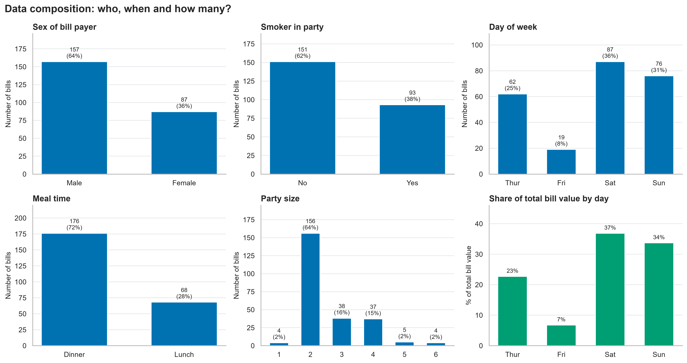

*Figure 1. Composition of the dataset by payer sex, smoking status, day, meal time and party size, plus the share of total bill value by day.*

**Interpretation (Figure 1)**

- **Customers:** bills are paid mostly by **men (64 %)** and **non-smoking parties (62 %)**.
- **Timing:** **dinner accounts for 72 %** of bills and **Saturday plus Sunday for 67 %**. Friday is thin (only 19 bills, 8 %), so any Friday conclusion is statistically fragile.
- **Party size:** **two-person tables make up 64 %** of the data. Parties of 1, 5 or 6 total just 13 bills, so estimates for those sizes are unreliable.
- **Revenue:** the share of total bill value mirrors the traffic. Saturday (37 %) and Sunday (34 %) generate over 70 % of revenue, Thursday 23 % and Friday only 7 %.
- **Takeaway:** the data describe a weekend-dinner, couples-dominated restaurant. Findings should not be generalised to weekday lunches or large groups without caution.

---

## 4. Data Distribution

This section studies the *shape* of the continuous variables: centre, spread, skewness, outliers and closeness to a normal distribution. This decides which statistical tests are valid later on.

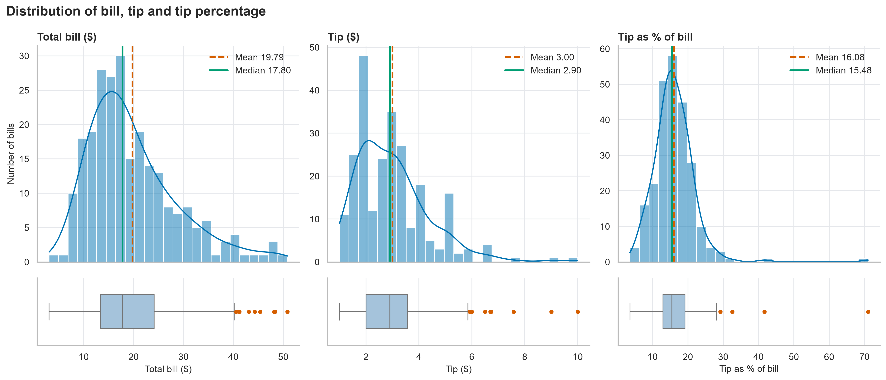

*Figure 2. Histograms with density curves (top) and box plots (bottom) for total bill, tip and tip percentage. Dashed lines mark the mean and solid lines the median; red dots in the box plots are outliers.*

**Interpretation (Figure 2)**

- **Total bill:** a single peak with a long right tail. Most bills fall between \$13 and \$24 (the interquartile range). The median is \$17.80 and the mean (\$19.79) is dragged right by a few bills above \$40.
- **Tip:** peaks around \$2-\$3 with a right tail up to \$10. Tips cluster on round amounts (\$2, \$3), which shows as small spikes in the histogram and is typical of human-chosen values.
- **Tip %:** tightly concentrated around **15 %** (IQR 12.9 %-19.1 %), consistent with the conventional tipping norm, with one very extreme point at 71 %.
- The box plots confirm that outliers sit only on the **high side** for bill and tip.

### 4.1 Normality and outliers

| Variable | Skewness | Excess kurtosis | Shapiro-Wilk p-value | Normal? | Skewness after log transform | Shapiro-Wilk p after log |
|---|---|---|---|---|---|---|
| Total bill | 1.13 | 1.22 | < 0.001 | No | -0.12 | 0.158 |
| Tip | 1.47 | 3.65 | < 0.001 | No | 0.08 | 0.056 |
| Tip % | 3.35 | 27.13 | < 0.001 | No | -0.37 | < 0.001 |

| Variable | Q1 | Q3 | Lower fence | Upper fence | Outliers | Share |
|---|---|---|---|---|---|---|
| Total bill | 13.35 | 24.13 | -2.82 | 40.30 | 9 | 3.7 % |
| Tip | 2.00 | 3.56 | -0.34 | 5.91 | 9 | 3.7 % |
| Tip % | 12.91 | 19.15 | 3.56 | 28.50 | 4 | 1.6 % |

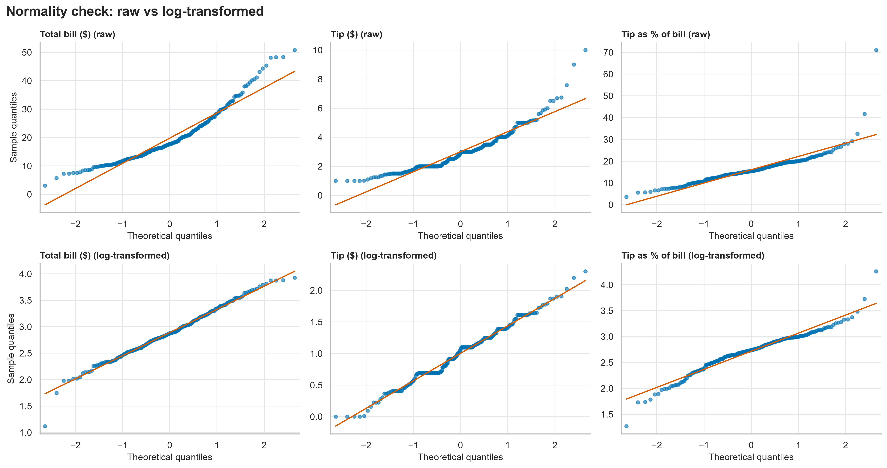

*Figure 3. Q-Q plots of each variable before (top) and after (bottom) a log transformation. Points on the red line indicate a normal distribution.*

**Interpretation (tables above and Figure 3)**

- **Skewness:** total bill 1.13, tip 1.47 and tip % 3.35, all clearly positive (right-skewed).
- **Shapiro-Wilk test** (null hypothesis: the data are normal): p < 0.001 for all three variables, so **normality is rejected** for the raw data. The Q-Q plots agree, because the upper tail bends away from the red line.
- **Log transformation:** after taking logs, skewness drops to about -0.12 (bill) and +0.08 (tip), the Q-Q points follow the line closely, and Shapiro-Wilk no longer rejects normality at the 5 % level (p = 0.16 and 0.06). **Bill and tip amounts are therefore approximately log-normal.**
- Tip % stays non-normal even after the log transform (p < 0.001) because of the 71 % outlier and a heavy lower tail.
- **Outliers (1.5 × IQR rule):** 9 bills above \$40.30 (3.7 %), 9 tips above \$5.91 (3.7 %) and 4 tip percentages outside 3.6 %-28.5 % (1.6 %). They are plausible large-party bills rather than errors (except possibly the 71 % tip), so they were **retained**.
- **Implication:** later analysis reports medians alongside means and confirms every parametric test with a non-parametric one.

---

## 5. Data Comparison

This section asks whether different groups (sex, smoking status, day, meal time) pay different bills or tip differently. Tip percentage is the main comparison metric, because raw tip dollars simply follow bill size.

### 5.1 Group summaries

| Group | Level | Bills | Mean bill (\$) | Mean tip (\$) | Mean tip % | Median tip % | Std. dev. tip % |
|---|---|---|---|---|---|---|---|
| Sex | Male | 157 | 20.74 | 3.09 | 15.77 | 15.35 | 6.48 |
| | Female | 87 | 18.06 | 2.83 | 16.65 | 15.56 | 5.36 |
| Smoker | Yes | 93 | 20.76 | 3.01 | 16.32 | 15.38 | 8.51 |
| | No | 151 | 19.19 | 2.99 | 15.93 | 15.56 | 3.99 |
| Day | Thursday | 62 | 17.68 | 2.77 | 16.13 | 15.38 | 3.87 |
| | Friday | 19 | 17.15 | 2.73 | 16.99 | 15.56 | 4.77 |
| | Saturday | 87 | 20.44 | 2.99 | 15.32 | 15.18 | 5.13 |
| | Sunday | 76 | 21.41 | 3.26 | 16.69 | 16.11 | 8.47 |
| Time | Lunch | 68 | 17.17 | 2.73 | 16.41 | 15.41 | 4.02 |
| | Dinner | 176 | 20.80 | 3.10 | 15.95 | 15.54 | 6.75 |

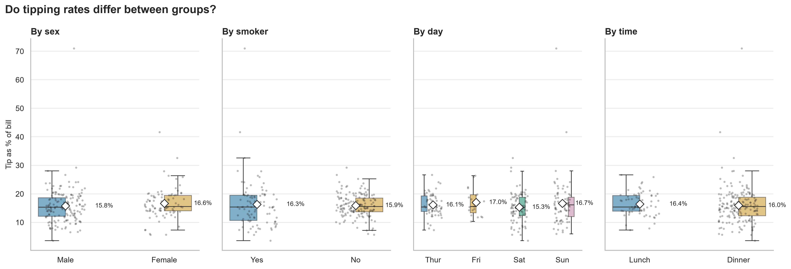

*Figure 4. Tip percentage by sex, smoking status, day and meal time. Boxes show the middle 50 % of bills, dots are individual bills and diamonds are group means.*

**Interpretation (Figure 4)**

- Across all four groupings the **boxes overlap almost completely**, and the group means lie in a narrow band of **15.3 %-17.0 %**. Tipping behaviour is remarkably uniform.
- **Smokers** show a visibly wider spread (standard deviation 8.5 points against 4.0 for non-smokers). Part of this is the single 71 % outlier, but smokers also include more low tippers. They are *less predictable*, not more or less generous on average.
- **Saturday** has the lowest mean tip rate (15.3 %) and **Friday** the highest (17.0 %), but Friday has only 19 bills, so its estimate rests on little data.

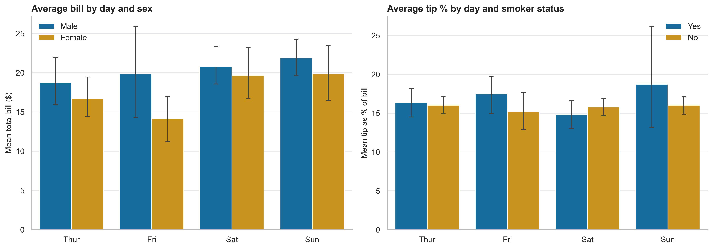

*Figure 5. Mean bill by day and sex (left) and mean tip percentage by day and smoker status (right). Error bars show 95 % confidence intervals.*

**Interpretation (Figure 5)**

- **Bill size:** men's average bill is higher than women's on **all four days** (the gap is largest on Friday), and Sunday has the largest bills. Most intervals overlap, so single-day gaps are not conclusive. Friday intervals are wide because of the small sample.
- **Tip rate:** the confidence intervals of smokers and non-smokers overlap on every day, so there is **no reliable difference in tip percentage by smoking status on any day**.

### 5.2 Statistical tests

Each two-group comparison used the Welch t-test and the Mann-Whitney U test. A result is flagged only when both agree. Effect size is Cohen's d.

| Question | Result | Conclusion |
|---|---|---|
| Tip % by sex | 15.8 % vs 16.6 %, p = 0.25 | No difference |
| Tip % by smoker | 16.3 % vs 15.9 %, p = 0.68 | No difference |
| Tip % by meal time | 16.4 % vs 16.0 %, p = 0.51 | No difference |
| Tip % by day (ANOVA / Kruskal-Wallis) | p = 0.47 / 0.61 | No difference between days |
| Bill by meal time | Dinner bills are **\$3.63 higher**, p = 0.002, d = 0.41 | **Significant**, small-to-medium effect |
| Bill by sex | Men's bills are **\$2.69 higher**, p = 0.019, d = 0.30 | **Significant**, small effect |
| Tip (\$) by meal time | Dinner tips are **\$0.37 higher**, p = 0.041, d = 0.27 | Borderline, small effect |
| Bill by day | ANOVA p = 0.043, Kruskal-Wallis p = 0.015, but **no Tukey pair is significant** (Sunday vs Thursday p = 0.067) | Weak evidence only |

**Interpretation**

- **Main finding:** people tip about **16 % regardless of who they are or when they eat**. Groups differ in how much they *spend*, not in how generously they tip.
- Men's higher absolute tip (\$3.09 vs \$2.83) is **not significant** (p = 0.14). It is explained by their larger bills.
- **Caution:** nine two-group tests were run, so borderline results (p close to 0.04) could appear by chance. The meal-time bill difference (p = 0.002) is the only one that survives a Bonferroni correction (threshold 0.0056).

---

## 6. Data Relationships

This section examines how the variables move together: numerical pairs first (correlation and regression), then categorical pairs (chi-square tests).

### 6.1 Correlation

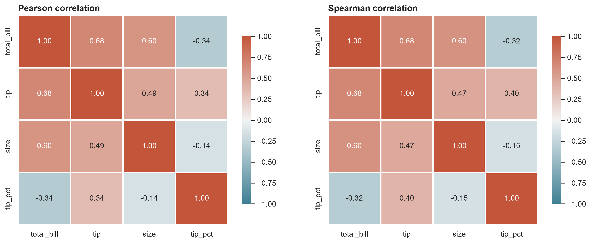

*Figure 6. Pearson (left) and Spearman (right) correlation matrices for total bill, tip, party size and tip percentage.*

| Pair | Pearson r | 95 % CI | Spearman ρ |
|---|---|---|---|
| Total bill and tip | 0.676 | 0.601 to 0.739 | 0.679 |
| Party size and tip | 0.489 | 0.388 to 0.579 | 0.468 |
| Total bill and party size | 0.598 | 0.511 to 0.673 | 0.605 |
| Total bill and tip % | -0.339 | -0.445 to -0.223 | -0.321 |
| Party size and tip % | -0.143 | -0.264 to -0.018 | -0.152 |

All Pearson p-values are below 0.001, except party size and tip % (p = 0.026).

**Interpretation (Figure 6 and table)**

- **Total bill and tip: r = 0.68.** This is the strongest relationship in the data. Spearman's ρ (0.68) is almost identical, so the link is not driven by outliers.
- **Party size and tip: r = 0.49**, and **bill and party size: r = 0.60**. Larger parties order more, and so tip more in dollars.
- **Bill and tip %: r = -0.34.** The bigger the bill, the *lower* the percentage tipped. **Party size and tip %** is only weakly negative (r = -0.14), a small effect.
- The Pearson and Spearman matrices tell the same story, so the conclusions are robust to the skewed distributions.
- Correlation does not prove causation. Bill and party size are themselves correlated, which the regression in section 6.6 separates.

### 6.2 Bill versus tip

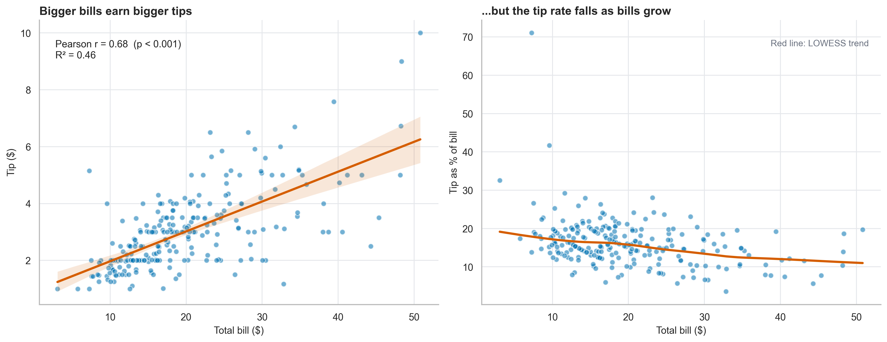

*Figure 7. Left: tip against total bill with a linear fit. Right: tip percentage against total bill with a LOWESS trend line.*

**Interpretation (Figure 7)**

- **Left:** a clear positive linear trend. The bill alone explains **R² = 0.46 (46 %)** of the variation in tips. The scatter fans out at larger bills, so big bills are tipped less predictably.
- **Right:** the trend line shows tip % **declining from roughly 19 % on the smallest bills to about 11-12 % on bills above \$30, then flattening**. Small bills are tipped at a higher rate, consistent with people rounding up or leaving a minimum tip. The 71 % point (a \$7 bill) is clearly visible as the outlier.
- Together: **tips grow with the bill, but less than proportionally**, so the dollar tip is not a constant percentage.

### 6.3 Bill versus tip by meal time and smoking status

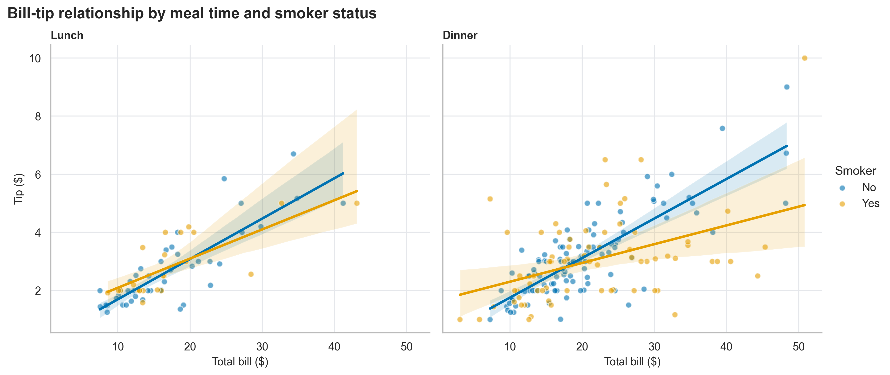

*Figure 8. Tip against bill, split by meal time (panels) and smoking status (colours), with fitted lines and confidence bands.*

**Interpretation (Figure 8)**

- **Dinner, non-smokers:** the steepest slope. The tip rises tightly with the bill.
- **Dinner, smokers:** a flatter slope and a much wider confidence band, so the tip is **less related to bill size**. Some smokers leave large tips on small bills and vice versa.
- **Lunch:** the two lines are close and their bands overlap heavily, partly because there are only 68 lunch bills.
- These are visual trends from small subgroups. They should be tested formally (with an interaction term) before being treated as fact.

### 6.4 Party size

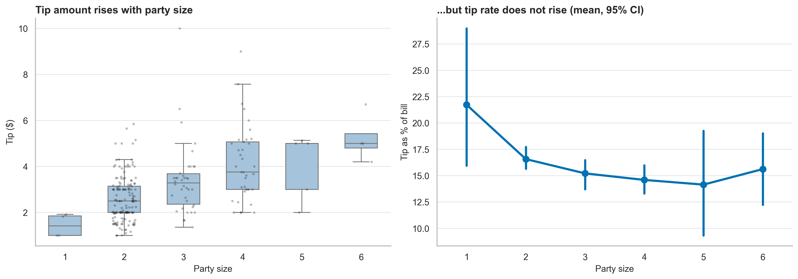

*Figure 9. Tip amount by party size (left) and mean tip percentage by party size with 95 % confidence intervals (right).*

**Interpretation (Figure 9)**

- **Left:** the median tip rises from about \$1.4 for singles to \$2.5 for pairs, \$3.3 for trios and \$3.8 for groups of four. Larger groups tip more dollars.
- **Right:** the tip *percentage* does **not** rise with party size. It falls from the party of one (only 4 bills, with an enormous interval) to about 15 %, and then stays flat. Larger parties tip more because they spend more, not because they tip more generously.
- Parties of 1, 5 and 6 have only 4-5 bills each, so their intervals are very wide and should not be over-interpreted.

### 6.5 Associations between categorical variables

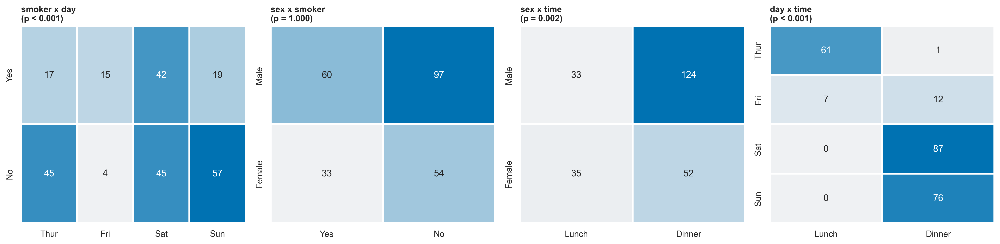

*Figure 10. Cross-tabulations of pairs of categorical variables, with chi-square p-values.*

**Interpretation (Figure 10)**

- **Smoker and day (p < 0.001, Cramér's V = 0.33, moderate):** the share of smoking parties changes by day. It is highest on Friday (15 of 19 bills) and Saturday (48 %), and lowest on Sunday (25 %) and Thursday (27 %).
- **Sex and time (p = 0.002, V = 0.21, weak to moderate):** female payers are relatively more common at lunch (40 % of women's bills are lunches, against 21 % of men's).
- **Sex and smoker (p = 1.0, V = 0.003):** no association at all. Smoking is independent of the payer's sex.
- **Day and time (V = 0.94)** is a *structural* association: lunch is served almost only on Thursday and Friday, and dinner on weekends. This is a property of how the data were collected, not a behavioural finding, and it means day effects and meal-time effects cannot be cleanly separated.

### 6.6 Multiple regression: what drives the tip?

A linear model, tip = f(total bill, party size), quantifies each driver while holding the other constant.

| Term | Effect on tip | 95 % CI | Significance |
|---|---|---|---|
| Total bill (per \$1) | +\$0.093 | \$0.075 to \$0.111 | p < 0.001 |
| Party size (per extra diner) | +\$0.19 | \$0.02 to \$0.36 | p = 0.025 |

Model fit: R² = 0.468 (adjusted 0.463), overall F-test p < 0.001.

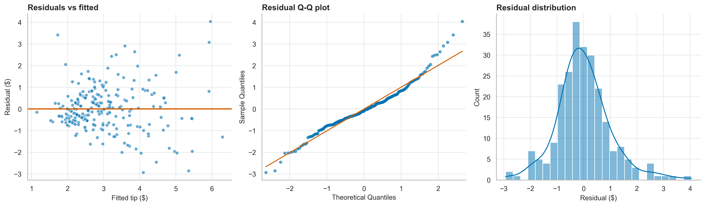

*Figure 11. Regression diagnostics: residuals against fitted values (left), residual Q-Q plot (centre) and residual distribution (right).*

**Interpretation (regression output and Figure 11)**

- **Model fit:** bill and party size together explain about **47 %** of tip variation. The rest is personal choice and service quality, which are not in the data.
- **Total bill:** each extra **\$1 on the bill adds about \$0.093 (9.3 cents) to the tip**. This is the dominant driver.
- **Party size:** with the bill held constant, each additional diner adds about **\$0.19**, a small but statistically significant effect.
- **Diagnostics:** residuals centre on zero with no curvature, so the linear form is reasonable. However, residuals are **right-skewed** (skewness 0.55, Jarque-Bera p < 0.001) and the spread widens at higher predicted tips (mild heteroscedasticity). The coefficients remain useful, but p-values and intervals are somewhat approximate. A log-log model or robust standard errors would be a sensible refinement.
- Because bill and party size are correlated (r = 0.60), the party-size coefficient is the less stable of the two.

---

## 7. Conclusions and Recommendations

1. **The sample is narrow.** It reflects weekend-dinner service to couples. Results should not be extended to weekday lunches or large groups.
2. **Tipping behaviour is consistent.** The typical tip is about 15-16 % of the bill, and it does not differ meaningfully by payer sex, smoking status, day or meal time.
3. **Spending differs, generosity does not.** Dinner and male-paid bills are significantly larger, and that is the only reason their dollar tips are higher.
4. **The bill is the main driver of the tip.** Each extra dollar of bill adds about 9 cents of tip. Party size adds a little more, independent of the bill.
5. **The tip rate falls as bills grow.** Small bills are tipped at a higher percentage than large ones.
6. **For planning,** forecast tips at 15-16 % of the bill. **To raise tip income,** increase the bill (dinner service, larger parties, weekend traffic) rather than targeting particular customer groups.

### Limitations

- Small subgroups (Friday, parties of 1, 5 and 6) give unreliable estimates.
- The data are observational, so the associations are not proof of cause.
- Residuals show mild heteroscedasticity and right skew.
- Day and meal time are almost perfectly confounded.
- Several tests were run, so borderline p-values (near 0.04) should be treated with caution.
- Service quality, a likely major driver of tips, is not recorded in the data.
